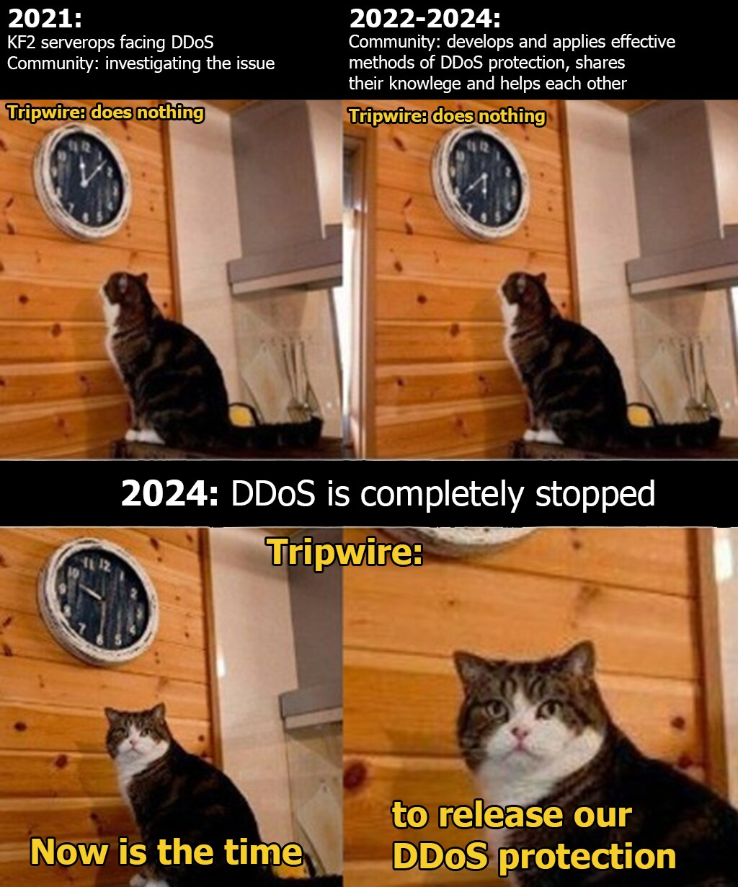

# KF2-AntiDDoS

[](https://golang.org)
[](CHANGELOG.md)
[](COPYING)

## Description
**DDoS protection of the kf2 server from one of the attacks faced by kf2 server operators community**  

Compiled versions for Windows and Linux are available on the [releases page](https://github.com/GenZmeY/KF2-AntiDDoS/releases).  
But you can build it yourself using the provided Makefile.  

## How it works
The program parses the output of the KF2 server(s) and counts the number of connections. If an IP exceeds the connection threshold and isn't verified as a player, the program will execute a deny script passing it the IP as an argument.  
The program will periodically execute the allow script, passing it a set of IPs blocked in the last period.  

## HowTo
```
Usage: <kf2_logs_output> | kf2-antiddos [option]... <shell> <deny_script> <allow_script>

kf2_logs_output            KF2 logs to redirect to stdin
shell                      shell to run deny_script and allow_script
deny_script                firewall deny script (takes IP as argument)
allow_script               firewall allow script (takes IPs as arguments)

Options:
  -j, --jobs N             allow N jobs at once
  -o, --output MODE        self|proxy|all|quiet
  -t, --deny-time TIME     minimum ip deny TIME (seconds)
  -c, --max-connections N  Skip N connections before run deny script
  -v, --version            Show version
  -h, --help               Show help
```

- Prepare an IP deny script for your firewall. The script must block the IP received by the first argument  
- Prepare an IP set allow script for your firewall. The script must unblock the set of IPs given by the arguments  
- Create a redirection of the output of all KF2 servers to the program input  
- In the parameters specify the scripts that you prepared and the shell that will execute them  

## Raw example
```
tail -f ./KFGame/Logs/Launch.log | ./kf2-antiddos-linux-amd64 /bin/bash ./deny.sh ./allow.sh
```

## Centos example 
(change paths and values as you need)  

**systemd service**  
```
[Unit]
Description=kf2-antiddos
After=network-online.target
Wants=network-online.target

[Service]
User=root
Group=root
Type=simple
ExecStart=/bin/sh -c '/usr/bin/kf2-srv log tail | /usr/local/bin/kf2-antiddos-linux-amd64 /bin/bash /usr/local/share/kf2-antiddos/deny.sh /usr/local/share/kf2-antiddos/allow.sh'
Restart=on-failure

[Install]
WantedBy=multi-user.target
```

pay attention to this part:  
`/usr/bin/kf2-srv log tail`  
I use a self-written system to manage the kf2 servers - the command specified here combines the output of all kf2 server logs into one stdout stream. If you want to protect several servers with antiddos, you also need to combine their logs into one stream. Replace this command with yours.

**deny.sh**  
```
#!/bin/bash

firewall-cmd --add-rich-rule="rule family=ipv4 source address=$1 port port=7777-7815 protocol=udp reject"
firewall-cmd --add-rich-rule="rule family=ipv4 destination address=$1 reject"
```

**allow.sh**  
```
#!/bin/bash

for IP in $@
do
    firewall-cmd --remove-rich-rule="rule family=ipv4 source address=$IP port port=7777-7815 protocol=udp reject"
    firewall-cmd --remove-rich-rule="rule family=ipv4 destination address=$IP reject"
done
```

## More info
- Tripwireinteractive forum thread about DDoS in kf2:  
https://forums.tripwireinteractive.com/index.php?threads/kf2-or-any-unreal-engine-3-server-on-redhat-centos-rocky-alma-linux-ddos-defense-with-the-help-of-firewalld.2337631  

- The most complete and useful article about DDoS in kf2:
https://www.zsdr.org/index.php/2023/10/03/killing-floor-2-or-any-unreal-engine-3-dedicated-server-on-redhat-centos-rocky-alma-linux-ddos-defense-with-the-help-of-iptables-firewalld/  
webarchive version (just in case):  
https://web.archive.org/web/20241107192154/https://www.zsdr.org/index.php/2023/10/03/killing-floor-2-or-any-unreal-engine-3-dedicated-server-on-redhat-centos-rocky-alma-linux-ddos-defense-with-the-help-of-iptables-firewalld/  

## Credits
A huge thank you to everyone who participated in the DDoS protection research! But I especially want to highlight these guys:  
- [Poor huwhyte Carl](https://steamcommunity.com/profiles/76561198083813369) - the first to publicly highlight the DDoS issue, actively researched DDoS and collected all useful information in one place  
- [baz](https://steamcommunity.com/profiles/76561198079062981) - researching the DDoS problem and sharing effective methods of protection  

## The Biggest Credits
And of course the biggest thanks to Tripwire Interactive, the developer of the game Killing Floor 2. These guys heroically did nothing for more than three years, leaving the DDoS problem to the community. And six months after the end of the DDoS they released an update with built-in protection for the server. Thank you, very timely!  



## Mirrors
- https://github.com/GenZmeY/KF2-AntiDDoS  
- https://codeberg.org/GenZmeY/KF2-AntiDDoS  

## License
**GPL-3.0-or-later**  
  
[](COPYING)  
